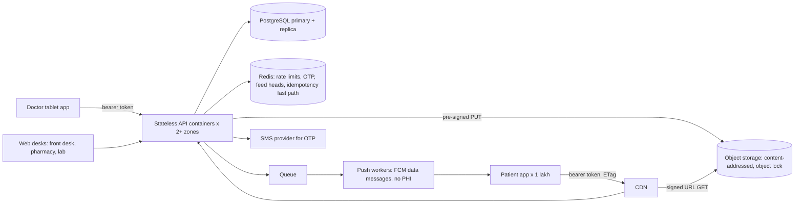

# Samford paperless OPD: scale design

This document describes how the paperless OPD flow would run in production for **up to 1 lakh (100,000) patient-app users and at most 50 doctors**, and what the current mock backend does instead. The mock exists so the doctor tablet app, the patient app and the web desks can be built and tested end to end. It is a single Node process with SQLite, and it is **not** the production architecture.

Measured numbers for the mock are in [load-test-results.md](load-test-results.md). They are single-node evidence on a developer machine, not a production capacity claim.

## 1. Load model

These are planning assumptions. Confirm them with the hospital before sizing hardware.

| Driver | Assumption | Resulting load |
|---|---|---|
| Installed patient apps | 100,000 accounts, about 1.5 profiles each | 150,000 profiles |
| Background polling | WorkManager every 30 minutes (15-minute platform minimum), one `GET /patient/notifications` with `If-None-Match` | 100,000 / 1,800 s ≈ **56 requests/s average**, almost all `304` |
| Foreground polling | 2% of users open at once, polling every 60 s | 2,000 / 60 s ≈ **33 requests/s** |
| OPD peak | 3x average between 09:00 and 13:00 IST | Design target **300 requests/s sustained, 1,000 requests/s burst** for notification polls |
| Doctors | 50 tablets polling the queue and events every 10-15 s while visible | About **7-10 requests/s** |
| Visits | 50 doctors x 40 OPD patients/day | **2,000 completed bundles/day**; peak about 0.2 bundles/s |
| Bundle size | 3 documents, about 4 page PNGs (100-400 KB each), one PDF per document and vector ink | About **1-3 MB per bundle** |
| Downstream reads | Pharmacy, each lab and the patient open each routed document 1-2 times | About 3x the uploaded bytes leave storage each day |

Writes are tiny in request terms. The two things that grow are **immutable blob storage** and **polling traffic from patient phones**.

## 2. Production architecture

### 2.1 API tier
- Stateless containers (two or more, across availability zones) behind a load balancer, autoscaling on CPU and request rate. Two small instances cover the design target with headroom; the per-request work is an authorization check and one indexed query.
- The `/api/mobile/v1` contract stays the same. Production implements the same OpenAPI document, idempotency rules, error codes, cursors and ETags, so the apps do not change.

### 2.2 Database
- Managed PostgreSQL with point-in-time recovery, a synchronous standby and a read replica for reports.
- Tables mirror the mock's entities: patients, visits, `document_versions` (immutable, one row per version), deliveries, lab results, feed events, tokens, OTP challenges and idempotency records.
- `feed_events` is partitioned by month and indexed on `(audience, seq)`. Each audience's newest sequence number is cached in Redis, so a `304` poll never touches PostgreSQL: the API compares the cached head and the client's cursor or ETag.
- Idempotency records for completion and addenda are permanent, like the mock. Other keys expire after 7 days. Sign-in replays are encrypted and expire after 24 hours.

### 2.3 Immutable blobs
- Page PNGs, PDFs and ink JSON go to object storage (S3, Azure Blob or GCS) under content-addressed keys such as `sha256/ab/cd/<sha256>`. Identical bytes are stored once.
- Uploads use **pre-signed PUT URLs** with the expected SHA-256 and length, so large files bypass the API. Before committing a bundle, the API verifies that each object exists, matches its hash and has the declared type and dimensions. A background validator re-checks the PNG, PDF and JSON structure and quarantines failures. A bundle whose blobs are missing returns `409 MISSING_BLOBS`, as in the mock.
- **Object lock (WORM) with a retention period** preserves the signed record. The hospital must set the retention period from its legal and medical-records policy; it is not decided here. Use versioning, cross-region replication and lifecycle rules that move objects older than about 90 days to a cool tier.
- Reads use **short-lived signed URLs through a CDN**. Objects are immutable, so the CDN can cache by hash for a year. URLs carry no patient identifiers. The bearer-token `GET /blobs/{sha256}` path remains for apps that cache by hash.

### 2.4 Feeds, polling and push
- Delta feeds per audience (`doctor:<id>`, `patient:<profileId>`) with opaque cursors, as in the contract.
- Add **FCM data-only push** ("something changed for profile X", no clinical content), sent by queue workers after each commit. Push removes most foreground polling and lets background polling drop to every few hours as a safety net.
- Notification text never contains diagnoses or values. The app fetches details with its own token.

### 2.5 Identity, OTP and abuse controls
- Patient OTP uses a DLT-registered SMS provider, with the same per-mobile and per-IP limits and lockout as the mock, plus Play Integrity or captcha on repeated requests. Codes are never returned by the API in production.
- Doctor tablets: managed devices (for example Samsung Knox or another MDM), short-lived access tokens with refresh tokens, device binding and remote revocation. The web admin "sign out device" action already revokes tablet tokens in the mock.
- Rate limits and OTP state live in Redis so every API instance enforces them.
- Legal electronic signature of prescriptions (for example DSC or Aadhaar eSign) is **out of scope**. "Signed" in this system means an immutable, hash-chained record (`recordHash`, `previousRecordHash`) attributed to an authenticated doctor.

### 2.6 Security, privacy and operations
- TLS everywhere, KMS-managed encryption at rest, India-region hosting and private networking for the database and storage.
- Plan for consent and purpose limitation under the DPDP Act 2023. ABDM/ABHA linkage is a separate, later integration.
- Keep the audit log append-only and exported to immutable storage. Record reads by doctors are audited, as in the mock.
- Monitor p95 latency per route, the 304 ratio, feed lag, push delivery, upload failures and the `MISSING_BLOBS` rate, with alerts.
- Disaster recovery: database PITR plus replicated object storage. Recovery-point and recovery-time objectives must be agreed with the hospital.

## 3. Storage growth

These figures are planning estimates from the load model, not measurements of real handwriting.

| Item | Per day | Per month (26 OPD days) | Per year |
|---|---:|---:|---:|
| Bundles | 2,000 | 52,000 | about 624,000 |
| Immutable blobs at 1-3 MB per bundle | 2-6 GB | 52-156 GB | 0.6-1.9 TB |
| Document versions (metadata rows) | about 6,000 | about 156,000 | about 1.9 M |
| Feed events (about 15 per visit) | about 30,000 | about 0.8 M | about 9.4 M (about 3 GB) |
| CDN egress (about 3 reads per document) | 6-18 GB | 0.16-0.5 TB | 1.9-5.6 TB |

Content addressing removes duplicates (for example unchanged pages carried into an addendum). Moving old objects to a cool tier keeps the cost of retention low.

## 4. What the mock does differently

| Concern | Mock backend | Production |
|---|---|---|
| Process and database | One Node process, SQLite (WAL) with JSON documents and expression indexes | Stateless API containers, managed PostgreSQL |
| Blobs | Stored inside SQLite and served by the API | Object storage with WORM retention, pre-signed uploads, CDN |
| Rate limits, OTP state | In process memory and SQLite | Redis shared by all instances |
| Push | None; apps poll with ETags | FCM data messages plus slower safety-net polling |
| SMS | None; the demo OTP is returned in the response and labelled | Real SMS provider; codes never returned |
| Authentication | Public synthetic personas; device-bound bearer tokens | Hospital identity, MDM-managed tablets, refresh tokens, attestation |
| Clinical signing | Immutable hash-chained record only | Same, plus legal e-signature if the hospital requires it |
| Exposure | One temporary Cloudflare Quick Tunnel for testing | Managed ingress with WAF and DDoS protection |

## 5. Measured mock evidence

[load-test-results.md](load-test-results.md) is produced by `npm run load-test`. The script creates a fresh, isolated database in the system temp folder; it never touches `data/`. It seeds 1 lakh synthetic patients, 50 doctors with today's queues, earlier visits with signed handwritten documents, deliveries and feed events. It starts the real isolated backend in its own process with **production rate limits** and measures:

- first and repeated (`304`) notification polls;
- profile feed pages and complete records;
- blob reads with a bearer token;
- doctor queues;
- concurrent visit completions, alone and while patients poll;
- idempotent replay of every completion, then a check that no duplicates were created.

Read the results as the behaviour of this single-node mock on one machine, with the load generator sharing that machine. They show that the contract's polling model and indexed queries hold up at 1 lakh profiles. They are not a forecast of production throughput.
